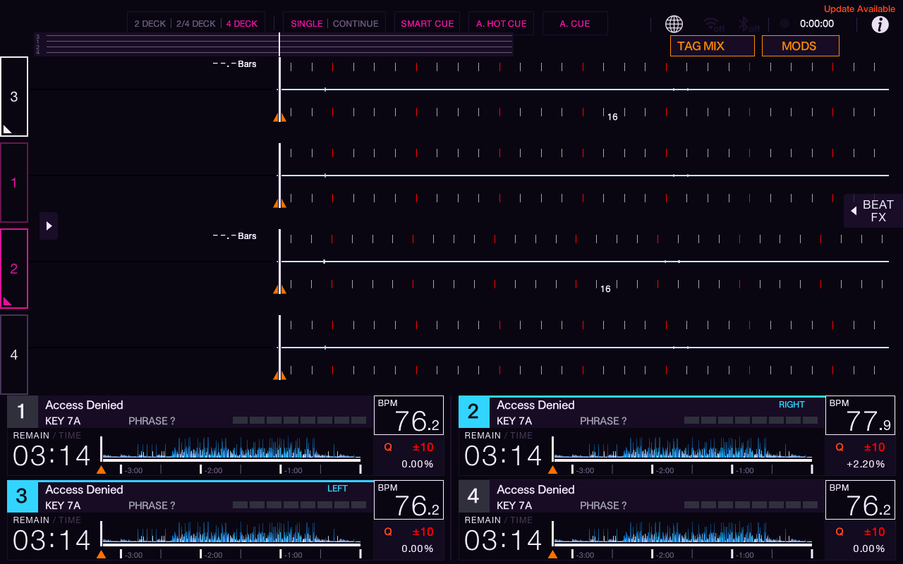

# AZ-MODS handoff for Claude, Grok and other collaborators

This branch saves Henry's development work from October 16, 2026 (America/Denver). Start with this file and [AGENTS.md](../AGENTS.md). The source is public so it can be reviewed without the original chat or Mac. A fresh clone does not contain the device system image, music library, SSH credentials or local restore point.

## Current state

**October 22 reconciliation:** development continued after the older heartbeat's `e79d4b6` reference. Read [the current continuation note](CONTINUATION-2026-10-22.md) before using an old restore script or choosing the next experiment. Stems composition, USB intent policy and the Waveform observer were committed in `1c3b1c7`; later work reached `47ecaf8`. MODS Shortcut 0.1.3 is a later source/archive/emulator candidate, while this checkout's catalog still lists 0.1.2. The Waveform function-entry hook was refused and produced no native observations. Preserve the newer emulator setup and untracked work.

**New passive SDK adapter:** [task-sdk-observer](../experiments/mods-shortcut-delivery/task-sdk-observer/) now connects the tested task wrappers and immutable transport to permanent SDK original slots. Capture opens only after both claims succeed; partial installation and failed workers retain forwarding storage, and late returns use copied values after closure. Its actual-source suite passes **660 assertions across 41 scenarios per plain, ASan/UBSan and TSan mode**, with five strict controls and an independently identical result. Exact-firmware binding passes 96 checks and 52 controls, also independently identical. ARM64 build and SDK validation pass. Worker log calls are bounded attempts, not delivery acknowledgements; quiet ticks do not diagnose quarantine. This is an unpublished, uninstalled observer with no native observations. The subsequent preparation below supplies the scalar planner and fresh runtime plan. Preserve all other gates.

**Sampler and controller baseline:** [preparation evidence](../experiments/mods-shortcut-delivery/task-sdk-observer/PREPARATION-EVIDENCE.md) records 81 scalar-planner checks/54 controls and 99 driver-policy checks/51 controls, both independently identical. Private startup/sampler mocks pass 253 checks/48 scenarios. The first live preflight stopped before acquisition because the guest lacked `stat`; corrected tar-metadata collection passes 1,440 mock checks/82 scenarios and completed one read-only 128-byte emulator mixer-frame acquisition. Driver identity and CRC pass a separate 36-check saved-receipt audit. No observer installation, input, service/core change or physical access occurred. The frame is not a later input baseline. That checkpoint preceded the action components and coordinator below. Its copied frame cannot replace a new action baseline. Existing staging, native-lifetime and release gates remain closed.

**Action preparation and coordinator:** [earlier components](../experiments/mods-shortcut-delivery/task-sdk-observer/ACTION-PREPARATION.md) remain frozen. The [new coordinator checkpoint](../experiments/mods-shortcut-delivery/task-sdk-observer/COORDINATOR-EVIDENCE.md) now composes them: 2,697 checks/70 scenarios with three strict controls, independently identical; pre-install compatibility, startup and runner-wiring checks also pass within their documented mock scopes. A fresh read-only attempt refused 54 saved mixer offsets against the 28-offset policy before controller acquisition or installation. Four extra offsets differ from idle, so stripping them would change state. All 147 fresh baseline files, original cores, loaded mods, caches and host state checked unchanged; no input, restart or physical access occurred. The emulator is released. No enabling manifest was created. The separately versioned [complete-overlay V2 policy](../experiments/mods-shortcut-delivery/task-sdk-observer/overlay-policy-v2/) now preserves all 54 supported offsets and passes independently reproduced source/pure checks; [private adapter integration](../experiments/mods-shortcut-delivery/task-sdk-observer/overlay-policy-v2/INTEGRATION.md) is recorded separately. It is not wired into the runtime runner. The later [writer/recovery checkpoint](../experiments/mods-shortcut-delivery/task-sdk-observer/overlay-policy-v2/RUNTIME-GAPS.md) reproduces queued preview replay and two sticky-overlay recovery gaps. A separate inert V2 planner validates 19 selected task/transport sources and proposed fresh scope; all live dispatch stays disabled. Next engineer enforced writer/queued-generation ownership and verify full original overlay plus host restoration before guarded restart. Only then review live wiring and consider a fresh run/backup. Do not retry the closed run, normalize settings or repeat earlier cleanup.

**Offline emulator ownership candidate:** a [separate phase-1 kernel patch](../experiments/emulator-overlay-ownership/) now binds mixer writes to an open file, run ID, epoch and exact sequence at the final mutation lock. A permanent fence rejects stale untagged writes and clear-all; CRC updates are transactional and frame/CRC reads share the lock. The default-off candidate has no producer handback or stopped recovery adapter. It has not been installed and does not open the observer runtime gate. Its actual-source host suite passes 146 assertions and seven strict controls per sanitizer mode with an independently identical result; 17 integration checks pass. Strict ARM64 compilation/modpost passes, with all 33 undefined symbols resolved in the pinned export table. The original CRC parameter-type metadata is retained. See its evidence and limits before further work.

**Offline instance/generation successor:** a [separate patch after phase one](../experiments/emulator-overlay-handback/) binds all tagged requests to a per-load 128-bit instance and adds same-broker `ROTATE`, which commits the full opaque frame and new generation together. V1 commands remain rejected, legacy mixer input stays fenced, and owner loss still retains the last frame. The actual-source suite passes 228 assertions and ten strict controls per sanitizer mode, independently identical, plus 22 integration checks. Strict ARM64 compilation/modpost passes with 35 matched exports; no installation occurred. This is only a kernel primitive. The [producer review](../experiments/emulator-overlay-handback/PRODUCER-REVIEW.md) requires creation-time tags, serialized request accounting and acknowledged baseline adoption through preview queues/reconnects. STATE showing a lower sequence is not cancellation; retagging old bytes remains accepted. [Stopped recovery](../experiments/emulator-overlay-handback/RECOVERY-CONTRACT.md) is unimplemented and must also preserve injected/idle mode. The subsequent offline libraries below implement local request/generation accounting; actual preview/transport integration and stopped recovery remain open. Keep the runtime runner disabled.

**Offline broker / producer libraries:** [mixer-broker](../experiments/emulator-mixer-broker/) adds complete grant/receipt accounting and creation-time immutable envelopes. The C library passes 203 assertions and six strict controls per sanitizer mode against seven exact extracted V2 kernel functions; independent results are identical. The Rust gate passes 19 tests/eight controls with independently matching functional results; diagnostic thread IDs account for output-hash differences. ARM64 object compilation passes, with no link or execution. Neither library is connected to the actual preview/forwarder or a wire adapter. Old raw bytes can still be reauthored under a fresh grant, and same-generation settings callbacks need event ordering; explicit counterexamples preserve those limits. Next compose the pinned preview queue/cache/reconnect/settings paths and then owned stopped recovery. No installation, emulator contact, release or runtime gate change occurred.

**Inactive actual-preview integration:** [preview-gate](../experiments/emulator-preview-gate/) now composes the pinned App and control classifier with immutable creation-time requests, exact full baseline/model adoption, release-only rearming, owned-mode legacy-cache exclusion and exact-ACK settings ordering. Production host compilation and 37 selected actual-crate tests pass, with 12 strict compiling controls; independent evidence is linked in the experiment. Main still supplies no owned backend, and config files are unchanged. Other-bus routing/bytes are preserved, but synchronous callbacks can delay sends; external mpsc backlog, native press duration, real transport/settings and owned stopped recovery remain unresolved. No runtime contact or installation occurred; all existing gates remain closed.

**Inactive bounded preview transport:** the separate [successor patch](../experiments/emulator-preview-transport/) removes owned mixer envelopes from the shared legacy channel and adds a dedicated mailbox whose bound includes reserved/in-flight work. Creation keeps the captured key; terminal stop rejects new work and a real thread join produces a distinct completion receipt. App confirmation now defers transient Busy without discarding its staged baseline. Production host compilation, 37 selected actual-crate tests and 11 strict compiling controls pass; each control must fail its exact source assertion, and a fresh independent run matches all functional fields. Main remains `None`. A separate actual-kernel serial counterexample passes 20 assertions per plain/ASan-UBSan mode and independently reproduces that two successful commits can precede a poll which sees only the latest overlay. These synthetic marker values do not validate a native button. Native dwell, real backend/settings, callback deadlines, unknown reconciliation and stopped recovery remain open. App exit still stops the guest without an owned join; that must be composed before runtime enablement. All live dispatch stays closed; no emulator/device access or release occurred.

**Inactive retained joined session:** the [next successor](../experiments/emulator-joined-session/) keeps the same route/backend alive after an actual worker join and retains the latest exact full ACK, callback disposition and acknowledged/released baseline. Poisoned diagnostics remain explicitly poisoned; every unresolved envelope survives even when its inherited uncertain bit is false. Production host compilation, 11 new actual-source tests and seven strict compiling controls pass; independent results and review are linked in the experiment. The other 115 listed tests were not repeated. This is bounded local accounting, not a history, authenticated receipt, restoration or teardown permit. App/main remain unchanged and inactive. Next compose a lifecycle owner that retains worker and supervisor resources through join on exit/startup-error paths; real settings must separately account for both host files and competing writers. No runtime/device contact, installation, release or gate reopening occurred.

**Inactive owned exit composition:** the [new lifecycle successor](../experiments/emulator-owned-exit/) pairs the exact port/worker and retains its joined session plus optional supervisor value through App exit and returning runner cleanup. Production host compilation, 12 new actual-source tests and seven exact-assertion compiling controls pass; independent evidence and platform-source review are linked there. The 126 inherited tests were compiled/listed and filtered. Post-join owner poison preserves exact completion with a visible poison flag; pre-take poison can still leave Running/unjoined work. Main remains a literal absent pair. Final owner Drop, macOS termination and process death can release resources; no guest Quit/stop or recovery permission follows from joining. Windows owns only a PID in the existing interface, so real owned construction is unavailable. Backend/receipt authority, callback deadlines, native dwell, both-file settings accounting and owned stopped recovery remain open. No runtime contact, installation, release or gate reopening occurred.

**Offline selected-mode restoration:** the [new kernel successor](../experiments/emulator-overlay-restore/) adds an input-only tagged RESTORE which commits all 152 raw bytes and explicit injected/idle mode together with epoch advancement and sequence zero. Idle requests must exactly match the pinned template, including CRC positions and tail; mismatches are refused. Owner/run/instance, permanent legacy fence and CRC policy remain intact. The focused actual-source suite passes 148 checks per plain, ASan/UBSan and TSan mode plus 11 strict controls and 26 static integration checks, with byte-identical independent results. Strict ARM64 compilation/modpost passes with 36 matched exports. See the experiment for review, build evidence and retained fixture failures. This is only an uninstalled primitive: older SPI snapshots can complete afterward, and retagged stale bytes remain possible. No native-stop authority, broker recovery adapter, host-file transaction or restart permit exists. Main and runtime dispatch remain inactive; all product/staging gates remain closed.

**Offline retained RESTORE broker:** the [separate C successor](../experiments/emulator-broker-restore/) binds each attempt to a complete source state, target mode/152 bytes and independent restore ID. It retains the exact command/result, caches duplicates without resending, refuses changed same-ID requests and reconciles UNKNOWN only from a full exact positive state. IDs survive FRAME/ROTATE; idle state is inspectable/restorable but cannot grant producer admission. Focused host checks pass 207 assertions and 16 strict controls per sanitizer mode; clean standalone C and strict ARM64 object compilation pass. A fresh independent run matches the entire result byte for byte; source review is retained. These are offline value/receipt mechanics, with no real backend/wire adapter, baseline or native-stop authority, durable journal, host restoration or guarded restart. Cached receipts are historical; no runtime or recovery permission follows. Frozen libraries/patches and all closed gates are preserved.

**Offline native64 controller adapter:** the [new C adapter](../experiments/emulator-native64-adapter/) now maps the frozen RESTORE broker to exact Linux ioctl structures, retaining a private CLOEXEC duplicate of an already-claimed controller fd. It validates full STATE, preserves explicit idle/injected mode, and classifies uncertain syscall results without retries or automatic cleanup. Its 137 focused assertions and 13 strict controls pass per sanitizer mode; one fresh independent run matches every result byte. Strict ARM64 compilation/shared linking also pass with real Linux headers and inspected musl dependencies; nothing was executed or installed. The host fixture uses a serial fd/syscall model, so it does not prove live VFS custody or exclude other duplicate writers. Native acquisition, preview/FFI integration, authoritative baseline/stop, durable recovery, both-file settings restoration and guarded restart remain open. Explicit disposal requires an external lifecycle decision; it grants no recovery permission. Main and runtime dispatch remain inactive; all staging and product gates remain closed.

**Inactive ACK-bound file-pair component:** [emulator-settings-pair](../experiments/emulator-settings-pair/) now retains both original host files and per-file replacement progress for explicit `FrameAck`/byte-pair inputs. Fixed directory-relative names, exclusive temporaries, file/directory synchronization, readback and bounded evidence distinguish partial or uncertain replacement; errors close later writes. Production host compilation, 24 focused tests and eight strict controls pass in private synthetic directories, with independently matching functional results; 138 inherited tests remain filtered. Two earlier fixture failures and the launch-context permission discrepancy are preserved: real sticky-mode rejection and copied-metadata privilege-bit rejection have separate scopes. A directory fd and identity checks do not exclude other writers or make two renames atomic. The actual preview/driver/boot writer audit is linked there. That primitive has no frame mapper, SettingsSink implementation, restoration, live construction or durable crash journal; the separate mapper below adds only value projection. Main remains inactive, and all native-stop, writer-exclusion, guarded-restart, staging and release gates remain closed.

**Inactive ACK-to-settings mapper:** the [separate mapper](../experiments/emulator-settings-mapper/) now derives the browse counter and 51 complete analog bytes from one full ACK, with explicit selector/TIME refresh and preservation of valid unselected fields. Its bounded strict parser refuses ambiguous/unsupported maps, transient selector bits and incomplete TIME pairs. Production host compilation, 27 focused tests and 13 exact-assertion controls pass, independently reproduced; 162 inherited tests remain filtered. The initial custom-assert diagnostic refusal and equivalent fixture repair are retained without changing production policy or runner criteria. Full ACK association is not authentication. This component performs no file I/O and adds no SettingsSink, live construction or recovery permission. The separate sink below now composes that callback with retained pair evidence. External writer exclusion, baseline/stop authority and restoration remain unresolved; all runtime/staging/release gates stay CLOSED.

**Inactive retained settings callback:** [emulator-settings-sink](../experiments/emulator-settings-sink/) now composes the actual SettingsSink with the frozen mapper and file-pair engine, retaining full ACK/source/target plans and partial/panic outcomes. Production host compilation, 22 focused tests and 14 exact-final-assertion controls pass with independent reproduction; 189 inherited tests remain filtered. The initial preparation-anchor failure and exact-line repair are retained. Real isolated files and actual route/worker types establish bounded callback behavior, using synthetic backend receipts. Two counterexamples preserve that constructor-baseline mismatch and later-epoch rearming can commit a native FRAME before the bridge refuses; these remain the frozen bridge’s limits, addressed locally by the separately constructed route below. Snapshots are noncoherent diagnostics, not durable recovery or callback-return proof. Main remains inactive; external exclusion, native/stop authority, restoration, final Drop/death and guarded restart remain open. No endpoint, installation, release or existing gate change occurred.

**Inactive single-generation route construction:** the [fixed-session successor](../experiments/emulator-fixed-session/) now retains actual backend/directory/settings/route custody, binds sink and route to the same full captured baseline and permits one cached grant with no later-epoch rearming. It returns an unarmed route and adds no worker/guest startup, endpoint or main wiring. Production host compilation, 25 new actual-crate tests and 16 strict compiling controls pass with an independent fresh reproduction; 211 inherited tests are compiled/listed and filtered. Blocked-call snapshots, constructor/unwind custody, returned-outcome poison salvage and real worker/lifecycle joins have separate evidence. This closes the prior local construction/rearming gaps for this immutable route; captured receipts are historical, backend aliases/separate constructions remain outside its fence, and external writer exclusion/native acquisition/recovery/durable custody remain open. Final Drop is not safe teardown. All runtime, stems, USB and release gates remain closed. No emulator or device contact, installation or release occurred.

**Inactive retained worker startup:** the [startup successor](../experiments/emulator-owned-startup/) now retains supplied backend/directory/supervisor custody and the actual returned port/worker pair before later constructor hooks. Explicit finish after a tested publication unwind promotes the exact pair if needed and performs a real join through the frozen lifecycle. Production host compilation, 16 new tests and 12 strict controls pass with an independent fresh reproduction; 236 inherited tests remain filtered. Busy finish returns InProgress without cancelling startup. Unreturned channel custody remains StartupUnproven; poison can retain unjoined work, and final Drop/death remain unresolved. A control-only survivor retains the sink's duplicated directory capability, while the original File Arc may expire. The [boundary review](../experiments/emulator-owned-startup/REVIEW.md) identifies guest-side Linux descriptor ownership versus host preview transport as a remaining native-integration boundary. Main stays inactive; no guest/backend acquisition, endpoint, installation, release or gate reopening occurred.

**Inactive bounded broker transport:** the separate [wire successor](../experiments/emulator-broker-wire/) adds explicit canonical C/Rust records, a borrowed serial dispatcher over the frozen broker, and a host backend owning a supplied stream. Production compilation, 20 new actual-crate tests/seven strict controls and 5,248 C checks/five controls per sanitizer mode pass with a fresh independent reproduction and retained-file audit; 252 inherited tests stay filtered. Cached receipts cannot become fresh ACKs, API errors remain uncertain, and an already committed duplicate cannot become a false local rejection. Intent and returned I/O evidence survive tested panic/poison boundaries. Pipe fixtures use synthetic state only. Main remains inactive; endpoint/peer binding, native acquisition and receipt authority, external exclusion, stopped recovery and durable custody remain open. All runtime and release gates stay CLOSED.

**Offline wire/native64 composition:** [focused integration evidence](../experiments/emulator-wire-native64/) now connects the frozen C dispatcher, broker and adapter to seven exact extracted driver methods in a serial host fixture. Four production translation units remain unchanged. Fourteen new scenarios and six strict controls per sanitizer mode pass in two fresh matrices with byte-identical results. The strengthened retained-file audit passes after a documented audit-only declaration-parser correction; no tests were repeated. Full raw/canonical bytes, original-fd reuse, actual modeled precommit refusal, postcommit synthetic EIO, lost response and same-capability alias limits are covered. The [acquisition review](../experiments/emulator-wire-native64/ACQUISITION-REVIEW.md) identifies the still-open original/duplicate custody and checked teardown gaps. This supplies no live CLAIM owner, endpoint, Rust/native bridge, baseline/stop authority or safe recovery. All runtime and release gates remain CLOSED.

**Inactive retained native64 attachment:** the [separate retained adapter](../experiments/emulator-retained-adapter/) now allocates/copies its owner before one-shot duplication and STATE validation. Failed validation keeps the duplicate, exact syscall result and all 208 diagnostic bytes; only complete matching state admits callbacks. Frozen snapshot/submit code is included byte for byte, and the acquisition journal stays unchanged during later broker operations. Fourteen new selectors and nine strict controls per sanitizer mode pass in two fresh matrices with byte-identical results; the retained-file audit passes. Explicit disposal remains externally gated and does not prove graph teardown or recovery. The original fd is still borrowed, raw descriptor diagnostics permit aliases, and no CLAIM owner, native authority, concurrent/durable custody or runtime wiring is supplied. Next retain original/CLAIM/pre/poststate custody and failed construction graphs; checked teardown remains separate. Main and all existing runtime/release gates remain CLOSED.

**Inactive retained CLAIM ownership:** the [new standalone owner](../experiments/emulator-claim-owner/) retains a caller-transferred original fd before one-shot preflight STATE, CLAIM and postflight STATE. Exact command, raw returns and all 208 diagnostic bytes survive failures; Committed CLAIM history remains independent of failed readiness, while Unknown cannot be promoted by a later matching snapshot. Actual modeled legacy-write and same-file alias counterexamples preserve these distinctions. Fourteen new selectors and 12 strict controls per sanitizer mode pass in two byte-identical fresh matrices, with a retained-file audit and no parent test replay. Idle acquisition preserves idle mode. This is offline source only, with no adapter/broker/dispatcher composition or live endpoint. Next retain the full construction graph through failures; alias exclusion, authoritative baseline/stop, checked teardown and durable custody remain open. Main and all runtime/release gates remain CLOSED.

**Inactive retained broker lifecycle:** the [new broker owner](../experiments/emulator-retained-broker/) publishes storage before one-shot synchronization setup and backend validation, preserving acquired resources, armed calls and raw outcomes on failure. Explicit disposal reports retained resources, permanently invalidates prior borrows and preserves first/latest failures; its external quiescence and uncertainty preconditions remain unproven. Exact frozen broker operations and C dispatcher are reused. Fourteen fixture selectors plus a separate actual pthread-wrapper smoke and 12 strict controls per sanitizer mode pass in two byte-identical fresh matrices, with a retained-file audit and no parent test replay. Synthetic refusal scripts do not prove contention safety. Full CLAIM/adapter/broker/dispatcher composition, owned transport/supervisor binding, external exclusion, native baseline/stop, recovery and durable custody remain open. Main and all runtime/release gates remain CLOSED.

**Earlier offline integration:** the [immutable value transport](../experiments/mods-shortcut-delivery/task-value-transport/) adds bounded invocation IDs and independent entry/return publication around the unchanged capture contract. Its 220 assertions and four strict controls pass per plain, ASan/UBSan and TSan mode, independently reproduced. A [synthetic ARM64 integration](../experiments/mods-shortcut-delivery/task-observer-integration/) now combines the actual capture, transport, submission wrapper and new executor adapter: 239 assertions, four executed controls and two CFI rejection controls pass. Independent review found and corrected a raced fixture counter; prior passing integration runs are explicitly superseded. The [pinned hook-lifetime review](../experiments/mods-shortcut-delivery/task-hook-lifetime/) and 56 installer assertions distinguish permanent original slots, partial installation and logical capture close from quiescence. That checkpoint supplied no SDK adapter. The new adapter below remains uninstalled; installed trampoline execution, live provenance and native task/dispatcher ownership remain gates. No core, package, catalog or emulator state changed.

**Prior offline findings retained:** the [native task review](../experiments/mods-shortcut-delivery/route-task-ownership/BOUNDARIES.md) distinguishes queued submission, TaskNo, execution and cleanup. The dispatcher guard is a shared initialized sentinel, not a per-event cancellation token; copying a dispatcher address does not establish retained ownership. Three alternate entries pass the unchanged static prologue policy, with no new claim. Separately, an [actual-source 0.1.3 lane counterexample](../experiments/mods-shortcut-lane-observation/) passes 82 assertions per sanitizer mode and independently reproduces false core-quarantine diagnostics with all SDK filters healthy. The candidate remains unpublished; its earlier lifetime/diagnosis claims are corrected. Source/archive, catalog and emulator state are unchanged.

**Earlier native route finding:** the separate [bounded route observer](../experiments/mods-shortcut-delivery/route-observer-burst/) at `0x1b01cf8` captured all four planned detents on empty Waveform, using 16 immutable off-thread slots. `w3` copies are +1,+1,−1,−1 under signed-32 interpretation; `w4` is 1,2,1,0 while changed RAW byte 34 is 129,130,129,128. All four records have the same opaque argument bits/TID and original LR `0x22c6e08`; those equalities do not prove native object or owner-thread identity. Five noncoherent status samples cover 135 validated own-module scalar reads, with no sampled losses or gates. [Runtime evidence](../experiments/mods-shortcut-delivery/route-observer-burst/runtime-evidence.md) verifies selective restoration of all 147 fresh baseline files, current settings/loaded mods, both cores, caches, absences and original host counter. The emulator is released. Host checks pass 32,339 assertions and six strict controls per sanitizer mode; binding passes 47 checks/30 controls, independently reproduced, with ARM64 validation. The prior one-shot source and evidence remain unchanged. Next distinguish queue admission from execution and prove event ownership; native returns, active children, cancellation and handback remain unproven. Do not repeat the successful four-detent capture unchanged.

**Separate findings retained:** the [earlier dispatcher observer](../experiments/mods-shortcut-delivery/dispatcher-observer/) accepted one hook but captured no entries; its 146-file restoration and missing historical status-sampler provenance remain separate. The [input-route review](../experiments/mods-shortcut-delivery/input-route/) and [SDK filter-chain tests](../experiments/mods-shortcut-delivery/input-stage/) explain static route and RAW-input limits; neither RAW values nor print order prove final native delivery. The [USB ownership review](../experiments/usb-browser-switch/activation-ownership/) identifies the final source value and service while native retention remains unresolved. The separate [overlay-watchdog order patch](../experiments/menu-watchdog-order/) passes 978 assertions per sanitizer mode and ARM64 compilation; it fixes a one-frame knob/button stall mismatch, not community-filter quarantine or native handback, and has never been installed. All remain unpublished research. No menu, recovery feature or community release follows from this observer. Earlier cleanup was not repeated.

For Henry and Jackson’s practice session, Grouped Deck Panels 0.1.0 has been staged on the physical FLOWMATIC USB after a verified backup. Read-only SSH status now confirms it is loaded on the physical deck; visual/selection validation remains pending. [Start with the practice guide](PRACTICE-NIGHT.md). The older key/phrase overlays and Set Clock are disabled but retained. The official core is unchanged. Grouped Deck Panels 0.1.0, Phase Strip 0.1.2 and MODS Shortcut 0.1.1 were published to the live GitHub catalog on October 17 as practice previews, with their tested source on main. [Release and install notes](RELEASE-2026-10-17.md) explain the physical install caveat. Other changes below remain emulator experiments. The stems issue is not fixed by these UI releases. **MODS Shortcut 0.1.2 now supersedes 0.1.1**, adding lower idle input work and safe request timeout; [update instructions](RELEASE-MODS-0.1.2.md) and physical validation limits apply. **Phase Strip 0.1.3 now supersedes 0.1.2** after Henry requested the old layout back; [current update instructions](RELEASE-PHASE-0.1.3.md) use normal Update from the remotely installed 0.1.2.

| Work | Location | Verified state / limits |
|---|---|---|
| Grouped Deck Panels 0.1.0 | [grouped-panels](../grouped-panels/) | Actual 4 DECK emulator preview: title, original Camelot key and relative phrase beside native BPM; cyan LEFT/RIGHT selection. All four decks and selection pairs checked. Replaces three older overlays in emulator. Staged on FLOWMATIC and confirmed loaded through physical-deck status; visual/selection checks remain pending. |
| B2B USB browser switch research | [research and manual evidence](../experiments/usb-browser-switch/) | Two emulator USBs independently restore selected tracks through native switching. Direct USB1/USB2 buttons are planned for the old WAVEFORM heading area and are not implemented. [V4](../experiments/usb-browser-switch/missing-boundary-investigation/) now explains the first-two missing V3 boundaries in a fresh emulator sequence: initial USB1/USB2 use the empty-list request path, while return to USB1 reaches the copied commit boundary. These observations establish admission/path details, not final readiness or activation. All 124 baseline files, permissions, inventory, cores and loaded mods were restored; the probe and opt-in were removed. |
| MODS Shortcut 0.1.2 | [mods-shortcut](../mods-shortcut/) | Optional clean heading removes WAVEFORM. MODS still opens SOURCE for native Mod Menu selection and confirmation. Published 0.1.2. In the prior 0.1.1, a later sustained visible-but-unresponsive failure is [confirmed as frame-filter quarantine](evidence/mods-filter-quarantine-2026-10-17/README.md): eight timing overruns disabled the handler while its UI stayed visible and an old request stayed pending. The earlier accepted-then-cancelled tap remains separately unexplained. 0.1.2 passes host/concurrency and emulator tests, including visible timeout recovery and three SOURCE requests with four decks playing. [Release instructions](RELEASE-MODS-0.1.2.md); physical testing remains pending. It intentionally hides on BROWSE. A later missing-button report on the waveform screen was traced to its own shortcut toggle being OFF; turn that row ON without Reload. |
| FLOW Neon theme | [theme experiment](../experiments/flow-neon-theme/) | Purple panels and pink native accents; sixth native theme in a separate emulator UI core build. Physical board unchanged. |
| Selected Deck Highlight 0.1.0 | [deck-focus](../deck-focus/) | Cyan lower-panel number and top edge follow left 1/3 and right 2/4 selection. All four pairs checked in emulator. 4 DECK view only; no waveform coverage. Reads native LED state, independent of PLAY/MASTER. |
| Stem Picks 0.4.1 | [harmonic-picks](../harmonic-picks/) | Header button disabled in the emulator at Henry's request; [verified screen and saved setting](evidence/stem-picks-hidden/README.md). Source and custom suggestions retained. It only opened the current native browser; automatic matching/loading remains unfinished. |
| Tag Mix 0.1.2 | [mix-bookmark](../mix-bookmark/) | Short TAG MIX button for tagging good combinations during practice. TAG COMBO saves two loaded tracks, approximate positions, BPM and manual stem notes. Saved-file checksums and UI verified across an emulator restart; older bookmarks browsed. No automatic audio changes or recall. |
| Phase Strip 0.1.3 correction | [phase-strip](../phase-strip/) | Restores the larger 0.1.1 geometry/placement controls with 3–1–2–4 order after Henry disliked 0.1.2 on hardware. [Emulator checked](evidence/phase-classic-0.1.3/README.md); physical test pending. Marker is independent of native waveform alignment. Published in the live catalog; [release/install instructions](RELEASE-PHASE-0.1.3.md). |
| Phrase Coach layout update | [phrase-coach](../phrase-coach/) | Counters moved into lower details headers; emulator checked with all four decks playing. Manifest still says 0.1.0: this is an unpublished source change and needs a distinct version before release. |
| Wider four-deck waveforms | Native UI | Collapse the left controls and right Beat FX panel. No waveform renderer patch or increase in vertical waveform height. Native waveform order 3–1–2–4; lower panels 1,2 / 3,4. |
| Set Clock | [set-clock](../set-clock/) | Disabled in the emulator at Henry's request; source retained. |
| Ordinary stems producer ordering | [separate candidate](../experiments/stems-ordinary-publication/) | Acquired decoded-prefix publication and locked envelope mapping pass 336 assertions per plain/ASan/UBSan/TSan run, independently repeated, and ARM64 compilation. This is a worker-path fix, not memory recovery or whole-engine race/lifetime proof. One emulator all-four ordinary load showed progressive/final frames, matching sources and play/pause; [scope and restoration](../experiments/stems-ordinary-publication/runtime-evidence/README.md). No physical validation or memory-recovery claim. |
| Staging / ordinary producer composition | [separate four-patch composition](../experiments/stems-staging-publication-composition/) | 336 ordinary and 1,020 staging assertions per sanitizer mode, independently repeated; private decode/prepared states and existing envelope exports stay unpublished/unchanged. Three negative controls discriminate guard loss or wrong ordering. Full ARM64 build passes; no composed installation, activation API or historical-failure attribution. |
| Stems memory-refusal recovery | [experiment](../experiments/stems-memory-retry/) | Separate upstream core patch. Reproduced a plausible cause; each of four decks recovered in controlled emulator tests after memory returned and playback paused. A physical incident now has [read-only telemetry](evidence/physical-stems-2026-10-17/README.md): one deck unavailable while three have decoded buffers, first on Deck 4 and later on Deck 1. Measured stem durations exceed available memory headroom in two captures, and the upstream failed-load cache explains missing retry. This is the leading mechanism; the original refusal log is absent. A new [production-path regression](../experiments/stems-retry-publication/) confirms recovery can publish after playback resumes; the [activation contract](STEMS-RECOVERY-ACTIVATION.md) remains unresolved. The patches remain emulator-only. |
| Camelot jog artwork | [experiment](../experiments/camelot-jog/) | Static artwork for two test tracks reached emulated jog displays. Stored key only; **does not follow Key Shift**. Not a finished community mod. |
| Recovery tooling | [tools/recovery](../tools/recovery/) | Verified backup and community-only restore algorithm, with tests on temporary folders. Private USB registration and real backups remain on Henry's Mac. |
| Chop Deck / Ableton | [performance experiment](../experiments/chop-deck/) | Playable browser audio demo and separate Live Session generator; FLOW Beat Link dependency checks pass. Actual AZ MIDI/audio, timing and Flow VJ coexistence remain unverified. No physical install. |
| Original SDK starter | [experiment](../experiments/sdk-starter/) | Template learning mod, not a published product. Author/source placeholders remain. |

Existing FLOW Beat Link, Key next to BPM, Mashup Helper, Stem Badge, Set Log and Deck Meters source is retained. Existing release history and catalog are separate from this preview branch.



## What to do next

Latest follow-up work is recorded in [October 17 investigation progress](INVESTIGATION-2026-10-17.md), including the confirmed physical MODS filter quarantine. The separate [private stems staging draft](../experiments/stems-recovery-staging/) now isolates recovered buffers and compiles for ARM64, but has no activation API and remains blocked from emulator installation by an unexplained ordinary-restart test failure. Its focused per-thread diagnostic now verifies real worker joins and captures an intentional codec-EOF failure, but does not reproduce or explain the historical failure. The [ordinary producer candidate](../experiments/stems-ordinary-publication/) addresses an independent worker/envelope race. A separate [composition](../experiments/stems-staging-publication-composition/) now adds explicit private suppression guards and passes actual-source interaction tests plus a full ARM64 build. It has no activation API or emulator installation and does not close the staging gate. The live community catalog still includes Phase Strip 0.1.3, Grouped Panels 0.1.0 and MODS Shortcut 0.1.2; this draft is not another release. Physical validation remains pending.

1. Preserve this baseline. Check repository/branch status before changing anything. Read each mod's README and the evidence before claiming a feature works.
2. The selected Grouped panels design is now an [actual emulator preview](evidence/grouped-panels/README.md). Review its native layout and metadata limits before hardware testing. The [earlier browser mockups](designs/main-screen/README.md) remain design studies; the implementation preserves native BPM, time and overview controls instead of replacing the whole lower screen.
3. Physical testing is still pending. Before any USB change, use Henry's existing local recovery kit, verify its backup and preserve its selected restore point. Test one community mod at a time away from a live set. Keep Kyle's official updater and core intact.
4. For stems, buffer absence has been confirmed on Deck 4 and later Deck 1; the symptom is not tied to a deck number. Follow the measured capacity and failed-load retry findings in the physical incident note. When practice permits, a controlled unused-deck memory release and different-track/return test can distinguish capacity from decode failure. The later long Track D requires 590.24 MiB of decoded buffers versus 114.53 MiB of headroom at capture. Do not silently install the experimental engine.
5. Preserve earlier versions, give changed packages distinct versions, build/validate, exercise the emulator, then make an explicit hardware-test/release decision.

Other requests still open: touch scrolling on the core Community Mods page; a live Key-Shift-aware Camelot display on physical jog screens; fully automatic one-button harmonic matching and custom result loading; further four-deck BPM/key/phrase layout refinement. Acapella filtering exists in the custom suggestion page but does not load tracks. CDJ integration was discussed; no integration patch was made. Replacing SINGLE/CONTINUE, SMART CUE or AUTO CUE has not been implemented.

Latest screen: [STEM PICKS hidden using its existing setting](evidence/stem-picks-hidden/README.md), with the [clean heading from MODS Shortcut 0.1.1](evidence/clean-heading/README.md). The WAVEFORM title area is blank and input-transparent. [Grouped panels and original MODS shortcut evidence](evidence/grouped-panels/README.md) records the original-key/relative-phrase limits and emulator rollback. The old Key next to BPM, Phrase Coach and Selected Deck Highlight packages are retained but unloaded in this preview.

Previous layout fix: [separated header shortcuts](evidence/header-layout-fix/README.md), checked in 2, 2/4 and 4 DECK views.

Latest demo evidence: [Mix Bookmark and Stem Picks](evidence/mix-demo/README.md). Both are emulator-only community builds; this turn did not change the existing experimental UI/stems cores or physical USB.

## Build and inspect

Pinned upstream URLs/commits are in [dependencies.json](dependencies.json). Clone the SDK next to this repository (`az-mods-sdk/` beside `flow-beat/`) and check out the recorded revision. Follow its official toolchain setup. From a mod folder:

```sh
python3 ../../az-mods-sdk/tools/azmod-pack build .
make test AZ_SDK=../../az-mods-sdk
```

The ARM64 build uses Docker. macOS host harness runs cover plain, ASan/UBSan and TSan but do not measure the no-I/O/no-allocation gates. Focused test commands are in each mod README. Do not mistake successful host tests for physical-device validation.

For a fresh emulator, follow the pinned [upstream emulator guide](https://github.com/Kyle-Hosman/xdj-az-emu/blob/06fc981707e69982c0554bb508e0c646c005a979/docs/guide.md). It requires a legitimate system copy from the user's own deck. Firmware, ROMs, boot images, music and databases are deliberately absent here. Henry's local emulator is already set up.

Original emulator automation recipes are in [tools/emulator-recipes](../tools/emulator-recipes/). They are development records, not general installers: read their prerequisites and paths before running. They alter emulator UI/playback and some perform memory-pressure tests or emulator library edits.

## Evidence and rollback artifacts

- [MODS Shortcut 0.1.2](../archives/mods-shortcut/0.1.2/): lower idle work and safe timeout recovery; [validation](evidence/mods-shortcut-0.1.2/README.md), physical test pending.
- [MODS Shortcut 0.1.1](../archives/mods-shortcut/0.1.1/): corrected blank-heading source/package, checks and [actual 4 DECK emulator evidence](evidence/clean-heading/README.md). Previous 0.1.0 remains available below.
- [Grouped Deck Panels 0.1.0](../archives/grouped-panels/0.1.0/) and [MODS Shortcut 0.1.0](../archives/mods-shortcut/0.1.0/): community packages, source snapshots, hashes and [actual emulator evidence](evidence/grouped-panels/README.md).

- [Selected Deck Highlight 0.1.0](../archives/deck-focus/0.1.0/): source snapshot, package, hashes, test notes.
- [Harmonic Picks 0.3.0](../archives/harmonic-picks/0.3.0/): source/package, 204 shortcut and 55 matching assertions, SDK results and emulator evidence. Earlier 0.1.0 and 0.2.0 artifacts retained; unshipped 0.2.1 prototype under experiments.
- [Phase Strip 0.1.3](../archives/phase-strip/0.1.3/), [0.1.2](../archives/phase-strip/0.1.2/) and [prior 0.1.1](../archives/phase-strip/0.1.1/).
- [Screenshots and historical reports](evidence/).
- [Stems patch/results](../experiments/stems-memory-retry/): 46 focused checks and four-deck recovery test; no core binaries included.
- [Artifact inventory](artifact-sha256.json): SHA-256 for archived files and selected evidence.

Historical reports preserve what was true at their test time, including “GitHub not changed.” This handoff now shares that work on a development branch. Archived `.entry.json` files originally contained prospective URLs. Grouped Panels 0.1.0, Phase Strip 0.1.2/0.1.3 and MODS Shortcut 0.1.1 are now published; other prospective entries still do not prove a release exists. See the October 17 release note for the exact promoted artifacts. Some archived instructions refer to the original local folder layout; use this index for the current paths.

## Collaboration

Use this branch and its commit as the shared baseline. Claude/Grok do not receive this chat automatically: give them the link to this file, or connect their GitHub integration and select this branch. If a tool only reads the default branch, provide the branch-specific URL or upload a source archive. Keep updates in commits with clear validation notes; use separate branches for independent experiments. Do not have multiple agents edit the same files concurrently without coordination.

Read [SESSION-NOTES.md](SESSION-NOTES.md) for emulator details and known constraints. Read [AGENTS.md](../AGENTS.md) for the user's recovery requirements. Never upload the private system image, SSH keys, pairing/access configuration, databases or complete USB backups.
