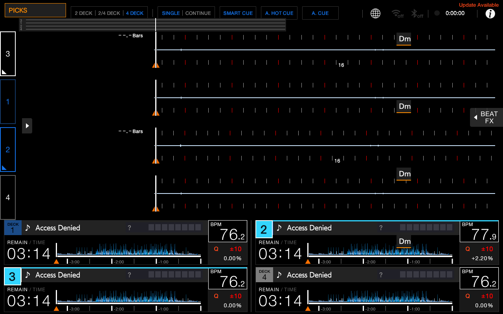

# AZ-MODS handoff for Claude, Grok and other collaborators

This branch saves Henry's development work from October 16, 2026 (America/Denver). Start with this file and [AGENTS.md](../AGENTS.md). The source is public so it can be reviewed without the original chat or Mac. A fresh clone does not contain the device system image, music library, SSH credentials or local restore point.

## Current state

The physical XDJ-AZ keeps its existing working community mods and official core. The latest changes below are **emulator previews**, not physical installations. Do not promise that the reported physical stems incident is fixed. This branch does not update the live community catalog, publish release tags or install anything on a deck.

| Work | Location | Verified state / limits |
|---|---|---|
| FLOW Neon theme | [theme experiment](../experiments/flow-neon-theme/) | Purple panels and pink native accents; sixth native theme in a separate emulator UI core build. Physical board unchanged. |
| Selected Deck Highlight 0.1.0 | [deck-focus](../deck-focus/) | Cyan lower-panel number and top edge follow left 1/3 and right 2/4 selection. All four pairs checked in emulator. 4 DECK view only; no waveform coverage. Reads native LED state, independent of PLAY/MASTER. |
| Stem Picks 0.4.1 | [harmonic-picks](../harmonic-picks/) | Same community ID, renamed STEM PICKS shortcut to the playable native browser; regular-track stem recipe guidance added to custom harmonic suggestions. Configure native BPM + KEY + MASTER filter, then physical LOAD 1–4. Custom suggestions remain read-only; no per-result stem availability check. |
| Tag Mix 0.1.2 | [mix-bookmark](../mix-bookmark/) | Short TAG MIX button for tagging good combinations during practice. TAG COMBO saves two loaded tracks, approximate positions, BPM and manual stem notes. Saved-file checksums and UI verified across an emulator restart; older bookmarks browsed. No automatic audio changes or recall. |
| Phase Strip 0.1.2 | [phase-strip](../phase-strip/) | Compact 680×34 strip at (48,46), lanes 3–1–2–4, above waveforms. Playhead x396 matches the native left playhead, not the optional centered playhead. |
| Phrase Coach layout update | [phrase-coach](../phrase-coach/) | Counters moved into lower details headers; emulator checked with all four decks playing. Manifest still says 0.1.0: this is an unpublished source change and needs a distinct version before release. |
| Wider four-deck waveforms | Native UI | Collapse the left controls and right Beat FX panel. No waveform renderer patch or increase in vertical waveform height. Native waveform order 3–1–2–4; lower panels 1,2 / 3,4. |
| Set Clock | [set-clock](../set-clock/) | Disabled in the emulator at Henry's request; source retained. |
| Stems memory-refusal recovery | [experiment](../experiments/stems-memory-retry/) | Separate upstream core patch. Reproduced a plausible cause; each of four decks recovered in controlled emulator tests after memory returned and playback paused. Physical incident has not been diagnosed from logs. |
| Camelot jog artwork | [experiment](../experiments/camelot-jog/) | Static artwork for two test tracks reached emulated jog displays. Stored key only; **does not follow Key Shift**. Not a finished community mod. |
| Recovery tooling | [tools/recovery](../tools/recovery/) | Verified backup and community-only restore algorithm, with tests on temporary folders. Private USB registration and real backups remain on Henry's Mac. |
| Chop Deck / Ableton | [performance experiment](../experiments/chop-deck/) | Playable browser audio demo and separate Live Session generator; FLOW Beat Link dependency checks pass. Actual AZ MIDI/audio, timing and Flow VJ coexistence remain unverified. No physical install. |
| Original SDK starter | [experiment](../experiments/sdk-starter/) | Template learning mod, not a published product. Author/source placeholders remain. |

Existing FLOW Beat Link, Key next to BPM, Mashup Helper, Stem Badge, Set Log and Deck Meters source is retained. Existing release history and catalog are separate from this preview branch.



## What to do next

1. Preserve this baseline. Check repository/branch status before changing anything. Read each mod's README and the evidence before claiming a feature works.
2. [Main-screen mockup is now available](designs/main-screen/README.md): compare Grouped panels (recommended) with Waveform first. It includes illustrative wide 3–1–2–4 waveforms, selection highlights, grouped BPM/key/phrase, PICKS and a proposed MODS shortcut. These are interactive browser design studies, not installed device features. Preserve stock controls and overview waveforms when translating a design to SDK/native layout work.
3. Physical testing is still pending. Before any USB change, use Henry's existing local recovery kit, verify its backup and preserve its selected restore point. Test one community mod at a time away from a live set. Keep Kyle's official updater and core intact.
4. For stems, obtain physical logs if the symptom returns; compare the failure with the emulator memory-refusal case. Do not silently install the experimental engine.
5. Preserve earlier versions, give changed packages distinct versions, build/validate, exercise the emulator, then make an explicit hardware-test/release decision.

Other requests still open: touch scrolling on the core Community Mods page; a live Key-Shift-aware Camelot display on physical jog screens; fully automatic one-button harmonic matching and custom result loading; further four-deck BPM/key/phrase layout refinement. Acapella filtering exists in the custom suggestion page but does not load tracks. CDJ integration was discussed; no integration patch was made. Replacing SINGLE/CONTINUE, SMART CUE or AUTO CUE has not been implemented.

Latest layout fix: [separated header shortcuts](evidence/header-layout-fix/README.md), checked in 2, 2/4 and 4 DECK views.

Latest demo evidence: [Mix Bookmark and Stem Picks](evidence/mix-demo/README.md). Both are emulator-only community builds; this turn did not change the existing experimental UI/stems cores or physical USB.

## Build and inspect

Pinned upstream URLs/commits are in [dependencies.json](dependencies.json). Clone the SDK next to this repository (`az-mods-sdk/` beside `flow-beat/`) and check out the recorded revision. Follow its official toolchain setup. From a mod folder:

```sh
python3 ../../az-mods-sdk/tools/azmod-pack build .
make test AZ_SDK=../../az-mods-sdk
```

The ARM64 build uses Docker. macOS host harness runs cover plain, ASan/UBSan and TSan but do not measure the no-I/O/no-allocation gates. Focused test commands are in each mod README. Do not mistake successful host tests for physical-device validation.

For a fresh emulator, follow the pinned [upstream emulator guide](https://github.com/Kyle-Hosman/xdj-az-emu/blob/06fc981707e69982c0554bb508e0c646c005a979/docs/guide.md). It requires a legitimate system copy from the user's own deck. Firmware, ROMs, boot images, music and databases are deliberately absent here. Henry's local emulator is already set up.

Original emulator automation recipes are in [tools/emulator-recipes](../tools/emulator-recipes/). They are development records, not general installers: read their prerequisites and paths before running. They alter emulator UI/playback and some perform memory-pressure tests or emulator library edits.

## Evidence and rollback artifacts

- [Selected Deck Highlight 0.1.0](../archives/deck-focus/0.1.0/): source snapshot, package, hashes, test notes.
- [Harmonic Picks 0.3.0](../archives/harmonic-picks/0.3.0/): source/package, 204 shortcut and 55 matching assertions, SDK results and emulator evidence. Earlier 0.1.0 and 0.2.0 artifacts retained; unshipped 0.2.1 prototype under experiments.
- [Phase Strip 0.1.2](../archives/phase-strip/0.1.2/) and [prior 0.1.1](../archives/phase-strip/0.1.1/).
- [Screenshots and historical reports](evidence/).
- [Stems patch/results](../experiments/stems-memory-retry/): 46 focused checks and four-deck recovery test; no core binaries included.
- [Artifact inventory](artifact-sha256.json): SHA-256 for archived files and selected evidence.

Historical reports preserve what was true at their test time, including “GitHub not changed.” This handoff now shares that work on a development branch. Local `.entry.json` files contain **prospective release URLs**; they are not proof a release exists. No new release/catalog promotion is part of this handoff. Some archived instructions refer to the original local folder layout; use this index for the current paths.

## Collaboration

Use this branch and its commit as the shared baseline. Claude/Grok do not receive this chat automatically: give them the link to this file, or connect their GitHub integration and select this branch. If a tool only reads the default branch, provide the branch-specific URL or upload a source archive. Keep updates in commits with clear validation notes; use separate branches for independent experiments. Do not have multiple agents edit the same files concurrently without coordination.

Read [SESSION-NOTES.md](SESSION-NOTES.md) for emulator details and known constraints. Read [AGENTS.md](../AGENTS.md) for the user's recovery requirements. Never upload the private system image, SSH keys, pairing/access configuration, databases or complete USB backups.
