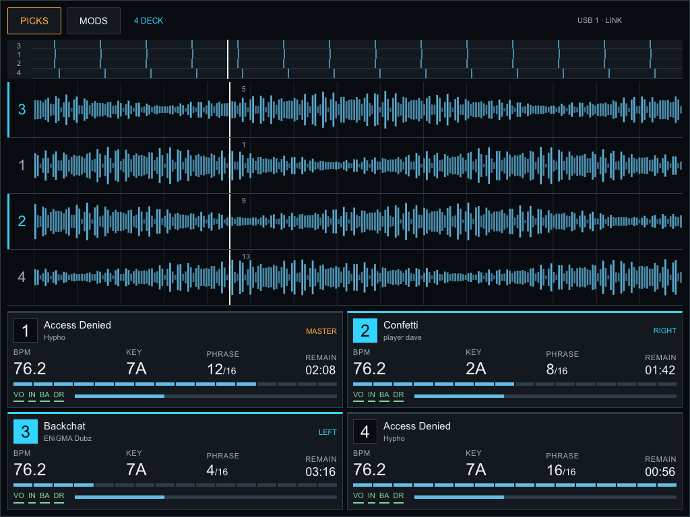
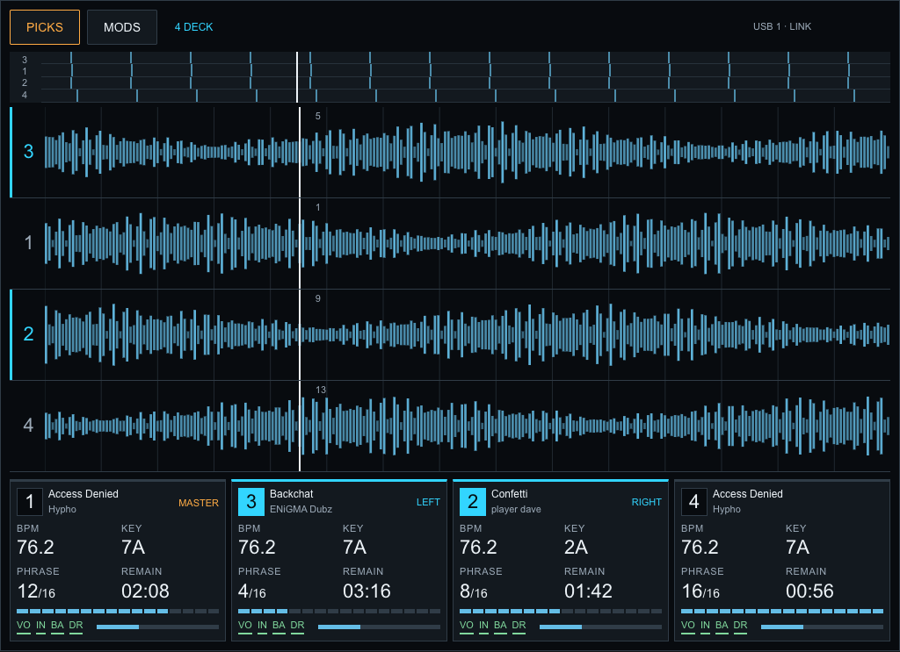

# Main-screen design preview

Two interactive layout concepts, created after Henry approved making a mockup. These are browser-based design studies, not screenshots of an installed mod or proof that the firmware can render this layout. The physical board, emulator mod binaries and live community catalog were not changed in this step.

- **Grouped panels** (recommended): keeps lower information panels at 1,2 / 3,4, with BPM, Camelot key, phrase and remaining time grouped together. Waveforms stay 3–1–2–4.
- **Waveform first**: one compact row of panels grouped by physical side (1,3 / 2,4), freeing vertical room for waveforms. This requires more native-layout work than the existing community overlays.

Open `preview.html` locally for the standalone interactive preview. `fragment.html` is its editable source for inline conversation rendering. Waveforms, BPM/key/phrase values and stem-pad state are illustrative sample data, not audio analysis or a live deck connection. Clicking deck numbers simulates physical selection for reviewing the highlight; it does not send deck commands. PICKS and MODS open local concept panels. The phase toggle affects only this preview. There is no LOAD/PLAY connection.

Henry clarified that stems are pre-generated on the USB. The normal view therefore keeps compact stem-pad indicators rather than a permanent loading banner. Prepared USB files still need loading/decoding into deck RAM; readiness cannot be inferred just from file existence. The separate emulator memory-refusal fix and pending physical diagnosis are unchanged.

Implementation follow-up: map the chosen layout to available SDK surfaces and native data, preserve access to the stock controls and track overview waveform, keep the 16-surface budget, avoid claiming shifted-key or stems-ready telemetry that is unavailable, and version/test individual mod changes before any physical deployment. This simplified chrome and compact four-across panel layout are proposals, not a drop-in SDK overlay.

Validation: rendered both designs in Chromium; checked switching left/right selection, previous-highlight clearing, MODS phase toggle, PICKS preview and Back navigation; no JavaScript runtime errors; checked narrow-width horizontal overflow and screenshots. Header/title typography was tightened after visual inspection. No device tests were needed for this isolated mockup.

## Implemented follow-up

Henry selected Grouped panels. [Grouped Deck Panels 0.1.0 and MODS Shortcut 0.1.0 now run in the actual emulator](../../evidence/grouped-panels/README.md). The implementation groups title/key/phrase in existing lower headers beside stock BPM, leaving time, overview waveforms and controls intact. Cyan LEFT/RIGHT indicators show physical selection. The MODS button opens SOURCE, followed by native MOD MENU selection and confirmation. It does not reproduce the mockup’s simplified controls or invent a direct SDK menu command. Physical testing is pending.
