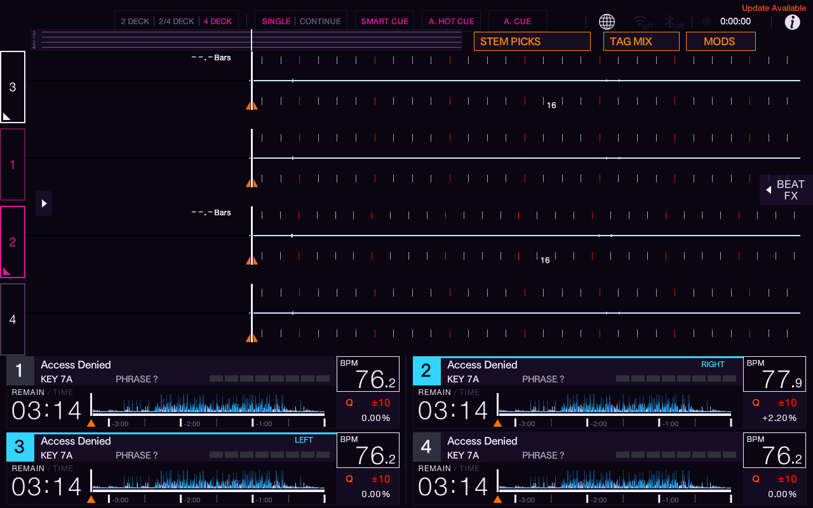

# Blank WAVEFORM heading — MODS Shortcut 0.1.1

The requested change leaves the WAVEFORM title area blank. There is no replacement diagram, deck-selection reader or LED callback. The mask is input-transparent, occupies `(0,0,174,46)`, and can be disabled independently through **Hide WAVEFORM heading**. Native tabs begin at x180; the phase strip begins at y46. The existing MODS → SOURCE → MOD MENU flow is unchanged.

The corrected build is host-validated, packaged locally and visually verified on the actual **4 DECK** emulator screen with Flow Neon. All sampled pixels inside the mask and beside it match RGB `(9,6,17)` exactly. No physical USB installation or release publication is part of these checks.

[Pixel samples](checks.json) and [loaded-mod/binary/core state](installed-state.txt) record the exact build. The staged and emulated-USB binaries both match the archived binary hash. The existing emulator UI and stems core hashes remain unchanged. No claim of 2 DECK visual verification is made for this build.

## Why the first mask color differed

The earlier emulator readback showed the mask as RGB `(11,7,20)` beside native Flow Neon background `(9,6,17)`. The fill path explains the difference:

1. SDK `fill_rect` dispatches through `community.c` to `azcm_fill_rect` in `screen_community.c`.
2. `azcm_fill_rect` calls the software framebuffer `fill_rect` in `ui_draw.c`.
3. That primitive applies `azm_theme(c)` once before storing pixels. `menu_theme.h` routes it to `azmod_dm_map`, and `day_mode.c` supplies the active palette.
4. Passing the already-themed `0x090611` causes another mapping: its channel spread is 11, so `dm_map_compute` treats it as gray with green lightness 6. Flow Neon's ground `(9,6,17)` and surface `(37,19,55)`, interpolated by `6/64` with integer truncation, yield `(11,7,20)`.

The corrected mask passes stock black `0x000000`. The core maps that once to the native ground: `(9,6,17)` for Flow Neon and the corresponding native black-ground color for the other pinned themes. Theme keys trigger redraw; unknown or missing theme keys hide the mask rather than guessing a color. The [source README](../../../mods-shortcut/README.md) records the supported palette keys and expected displayed colors.

This trace was checked against the pinned core and [workspace Flow Neon patch](../../../experiments/flow-neon-theme/flow-neon.patch). No core file was changed.

## Verified checks

- Docker ARM64 build and SDK validation pass, including the packaged `.azmod`.
- 264 SOURCE-input assertions and 232 component assertions pass plain and ASan/UBSan.
- Official macOS SDK harness: plain, ASan/UBSan and TSan each pass 9 measured checks.
- Linux plain SDK harness: 11 checks pass, including no-I/O and no-allocation gates.
- Source contains no deck-selection state or `on_frame` callback. The mask's surface has no input callback.

The official harness lacks `frame_filter`; it checks the hidden SOURCE-button fallback plus active mask/layout behavior. The dedicated full-component tests exercise the registered SOURCE filter. Neither host suite proves physical-device behavior.

## Exact artifacts

- Binary SHA256: `48159c3165c07f66c9ace13f1cbb75939cae589527b375aa982b9ba7a45262ca`
- Package SHA256: `d04a4c616c7fbb3f627d85bd34a6ae034f33dda13b89939a0048035f87caa117`
- [Unpublished package and source snapshot](../../../archives/mods-shortcut/0.1.1/)
- [Prior 0.1.0 package retained](../../../archives/mods-shortcut/0.1.0/)

The new `.entry.json` contains prospective release URLs only. The parent task installed and captured this exact build in the emulator. Package/documentation work used the saved evidence without emulator access. Physical-device behavior remains unverified.
