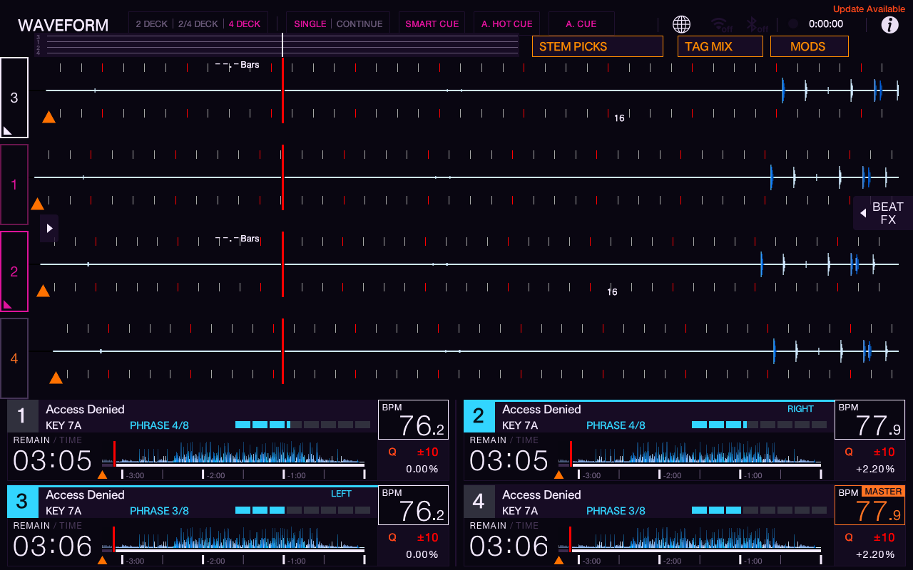

# Grouped panels: actual emulator preview

Tested October 16, 2026 (America/Denver). These are native emulator screenshots of **Grouped Deck Panels 0.1.0** and **MODS Shortcut 0.1.0**, not the earlier browser mockup. The physical USB/deck and live community catalog were not changed.

## Result

Each lower header groups the title, original Camelot key and relative eight-bar phrase beside the native live BPM box. Cyan numbers and top borders, plus LEFT/RIGHT labels, identify the deck selected by each physical control side. The lower panels stay 1,2 / 3,4, while the scrolling waveforms stay 3–1–2–4. Native remaining-time displays, overview waveforms, tempo and quantize controls remain visible. Headers are input-transparent.

The existing Phase Strip, Stem Picks and Tag Mix remain. Set Clock remains disabled. The wide waveforms use the existing collapsed native side panels; this change does not increase their vertical height.

**MODS** opens native SOURCE. Select **MOD MENU**, then tap it again or press the browse knob to enter. If it was already selected, one tap enters. The SDK has no direct public operation to open that menu. The shortcut does not guess rows or automatically confirm native menu choices.

## Checks performed

| Check | Result |
|---|---|
| ARM64 community builds and SDK validation | Both passed; distinct community IDs, version 0.1.0 |
| Host SDK harness | Both passed plain, ASan/UBSan and TSan |
| Grouped layout/data/paint focused suites | All seven passed; data 4,110 checks, renderer 384 scenarios / 64,933 assertions |
| Shortcut focused suites | 389 assertions passed plain and ASan/UBSan; exercises actual input filter |
| Linux SDK harness in existing build container | Grouped 10 checks and Shortcut 11 checks passed; no-I/O/no-allocation gates measured and passed |
| One loaded deck, three empty | Unknown/empty metadata displays correctly; native BPM/timing clear |
| Four loaded decks playing | Original key and phrase readouts appeared on all four; stopped playback afterwards |
| Physical-control selection | All four left/right selection pairs checked; highlights independent of PLAY/MASTER |
| Settled idle selection | Both selected markers stayed visible in all eight captures; [record](selection-idle-check.json) |
| 2 DECK and 2/4 DECK | Grouped headers hidden; MODS moves clear of existing shortcuts |
| MODS action | SOURCE destination confirmed in 2 DECK and 4 DECK; native MOD MENU entry confirmed |
| Loaded versions | Both 0.1.0; no community suspension; [state](installed-state.txt) |
| Existing emulator UI/stems cores | SHA-256 unchanged across install and final check |

The official SDK test harness lacks `frame_filter`. Shortcut harness checks, including its Linux no-I/O/no-allocation measurements, cover the hidden fallback; full-component focused tests and actual emulator input check the enabled SOURCE action. macOS harness runs do not measure those two gates. No physical-device validation is claimed.

The settled-idle check follows a transient capture during rapid selection switching. It is a short stability check, not a long-running soak test.

## Evidence

- [Four decks playing](four-playing.png), [one loaded / three empty](one-loaded-decks.png).
- Selection: [1+2](selected-1-2.png), [1+4](selected-1-4.png), [3+4](selected-3-4.png), [3+2 idle](selected-3-2-idle.png).
- [2 DECK](two-deck-final.png) and [2/4 DECK](two-four-deck.png).
- [SOURCE through MODS](mods-source-final.png), [native Mod Menu entered](native-mod-menu-open.png), [SOURCE from 2 DECK](two-deck-mods-source.png).

## Limits and rollback

Key is the original analyzed key; it does not follow Key Shift. Phrase is a relative eight-bar counter anchored near first playback, not detected song structure. Library metadata may take roughly 20 seconds plus scan time after a load; uncertain/conflicting data stays unknown. Native stems behavior and the separate experimental stems core are unchanged.

The emulator now loads `grouped-panels` instead of `key-next-to-bpm`, `phrase-coach` and `deck-focus`. Their binaries/settings are preserved. Those three older packages must be unloaded, not merely hidden, to release their 12 surfaces. The complete current preview uses eight of the SDK's 16 global surfaces.

For emulator rollback, remove `grouped-panels` and `mods-shortcut` from the community enabled lists, restore the previous three IDs, and restart the emulator deck application. The exact pre-install enabled lists remain in Henry's local `work/grouped-panels/emulator-backup/`; a guarded localhost-only restore helper sits beside that backup. Restore only those community lists, leaving the core and unrelated settings intact. Versioned packages and source are in [Grouped Panels archive](../../../archives/grouped-panels/0.1.0/) and [MODS Shortcut archive](../../../archives/mods-shortcut/0.1.0/).

Before any separately authorized physical USB change, follow the recovery requirements in [AGENTS.md](../../../AGENTS.md). Emulator verification is not a reason to overwrite newer official files or discard the known-good restore point.
