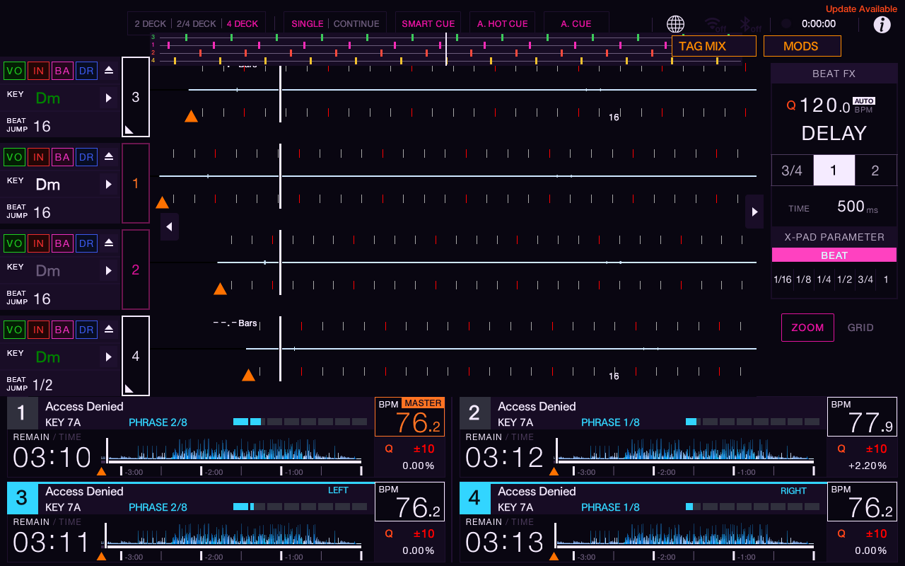

# Classic phase layout restored — 0.1.3

Henry preferred the older phase meter after trying 0.1.2 on the physical board. This build restores 0.1.1’s x212, 838 by 47 pixel geometry, center marker and saved Top/Band/Low position controls, retaining the requested 3–1–2–4 lane order. The decorative surface now has no input callback.

The exact ARM64 binary loaded in the emulator and was checked with four loaded, playing decks. Deck labels and colored beat ticks use 3–1–2–4 from top to bottom. The default 4 DECK-only setting hides the strip in 2 DECK and restores it when returning to 4 DECK. Test tracks were paused after capture. Existing emulator UI and stems core hashes were unchanged.

This screenshot includes the separate, unpublished FLOW Neon core theme and TAG MIX preview. TAG MIX overlaps the restored ruler’s right edge; it is not installed in the reported physical setup and is not bundled in this release. The classic Top placement extends 12 pixels into the observed waveform band, as 0.1.1 did. The marker is independent of the native waveform playhead. This is a restoration of the requested old layout, not automatic native alignment. The native Font/Touch input and physical layout still need a hardware check.

The source’s focused renderer tests cover classic bounds, saved placement migration, visibility, no-input surface, missing grids and 3–1–2–4 mapping across 123 paint scenarios (plain and ASan/UBSan). ARM64 build, SDK package validation, and all eight measurable SDK harness checks in plain, ASan/UBSan and TSan passed. macOS does not measure no-I/O/no-allocation gates.

The MODS touch failure remains separate and unresolved; its diagnosis-only patch is not bundled. No physical configuration, core, USB files or controls were changed during this preview.
