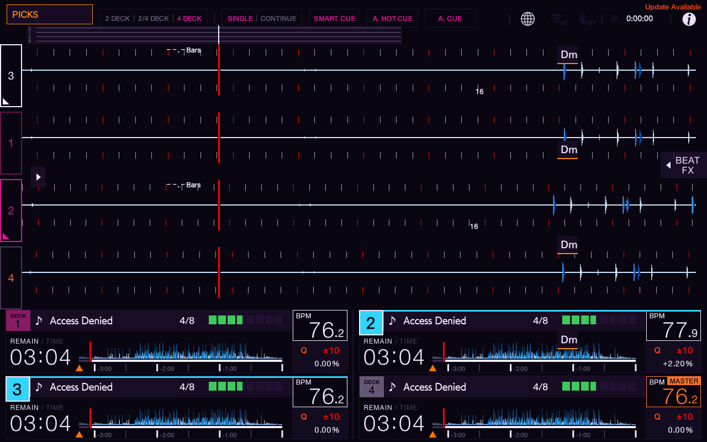
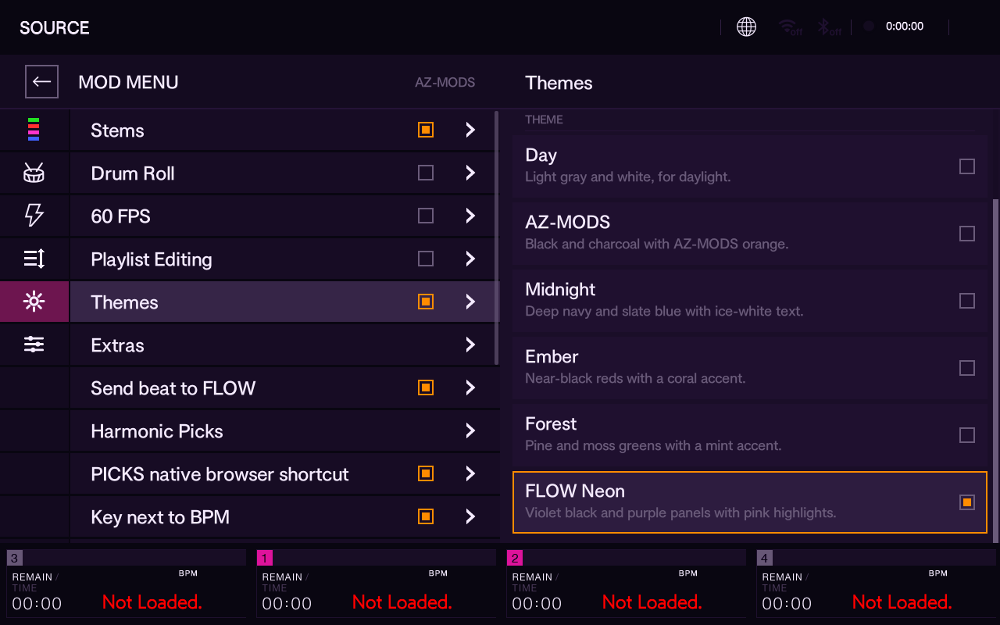

# FLOW Neon — custom purple/pink theme

Emulator preview 0.1.0. Added as a sixth choice in **Mod Menu > Themes > FLOW Neon**; the original Day, AZ-MODS, Midnight, Ember and Forest choices remain intact. Turn Themes off for the stock appearance.

- Near-black violet background: `#090611`
- Deep-purple panels: `#251337`
- Pale lavender text: `#F5EBFF`
- Pink selection accent: hue 320°, using the existing luminance-preserving mapping
- Native orange MASTER/warnings and stem-pad colors retain their existing meanings. Selected Deck Highlight's independent cyan badges remain cyan; this theme does not edit community-mod code.

This is an **emulator-only UI core experiment**, not a community-mod package. SDK 1.2.3 can read theme colors but does not register a new native full-screen palette. The patch therefore adds one palette and one picker entry to the existing native theme system. No audio, stems code, firmware address, hook implementation or existing palette was changed. Do not copy this emulator core to the physical USB.

## Build and review

`flow-neon.patch` applies to upstream `Kyle-Hosman/xdj-az-mods` commit `3e0c5cb010454228f4ee63226b60d060494eeaae`. Use `git apply --check` before applying. Follow upstream BUILDING.md to extract required assets from the matching legitimate local core and build the `azmod` target with `azmod-build:18.04`. Firmware-derived headers, core binaries and private settings are deliberately not published here. `build-info.json` records the tested binary hashes and palette.

## Validation

- ARM64 release build passed `-Wall -Wextra -Werror` and undefined-symbol linking checks.
- Patch applies cleanly to the pinned upstream; original five palettes and mapping code are byte-for-byte unchanged.
- Selected FLOW Neon in the emulator's Themes menu; verified its saved key and enabled state.
- Switched through Day during UI navigation, then reapplied FLOW Neon and confirmed it survived an EP147 restart.
- Existing community mods report loaded, with Set Clock still off.
- Loaded four tracks and inspected the four-deck layout, including narrow panels and expanded waveform area.
- Prior emulator core/settings copied and hash-verified before installation. The separate experimental stems engine hash is unchanged.

These checks establish an emulator preview, not physical compatibility or a fix for the user's stems incident. Palette code does not preload/decode stems.

## Recovery

For the prior appearance, pick another theme or disable Themes. To remove the experimental core entirely, Henry's original local workspace has `work/flow-neon/azmod-original.so`, matching saved settings and `restore-emulator.py`. That localhost-only script verifies the backup, stops EP147, atomically restores the UI core and settings, verifies the written hashes, confirms the stems engine is untouched and restarts EP147. The backups and script stay with that private workspace; a fresh Git clone does not contain the backup. Full rollback execution has not been rehearsed; backup integrity has been verified.

The physical USB and its private recovery point were not modified.
