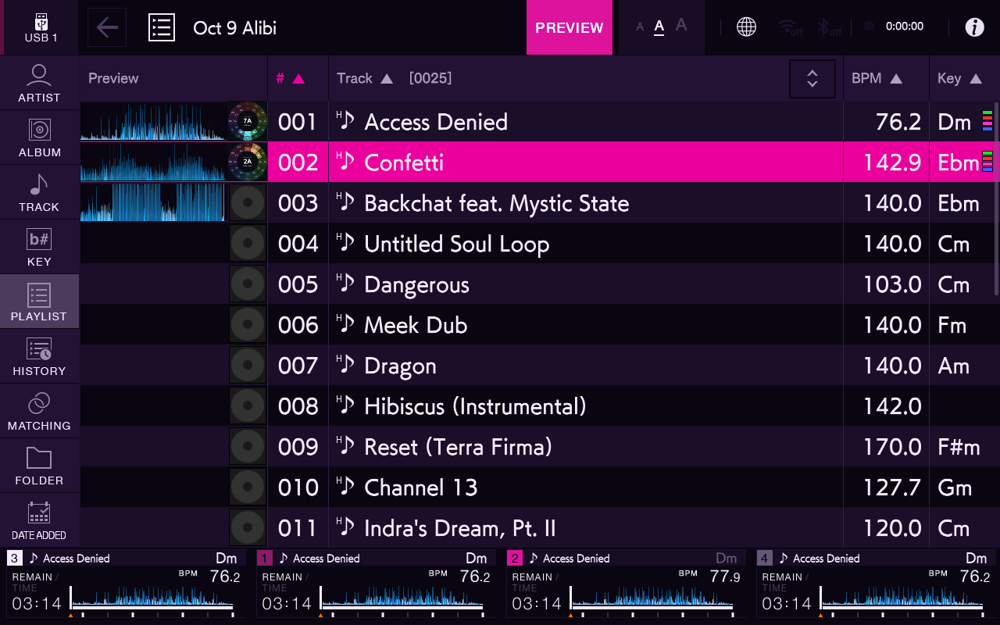
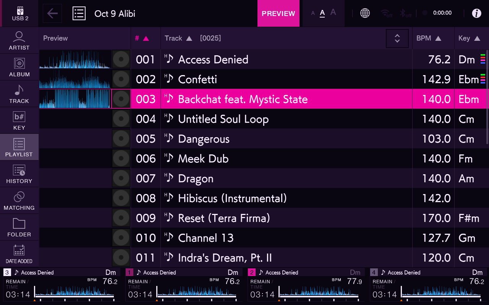

# USB browser switch: research only

Goal: one deliberate USB 1 / USB 2 action for B2B browsing that returns to each medium's previous playlist and row. This is an activation workflow, not another shortcut that merely opens SOURCE.

Status, 2026-10-17: static local source/disassembly investigation, a successful manual native-switch test on two emulator USBs, and an [observation-only probe](probe/README.md) loaded and then removed from the emulator. The probe cannot activate USBs. No complete USB-switch mod has been built or installed; physical hardware is unchanged. The next activation work and requested heading placement are recorded in [USB Buttons next update](../../usb-buttons/NEXT-UPDATE.md).

## What the public SDK supports

The pinned `azmod-mod.h` provides read-only library enumeration, a coarse current view, input filtering, and guarded native hook claims. It has **no direct USB activation service, active browser MediaID getter, or browser history/cursor restore service**. `post_ui` is drained on the core overlay UI thread; it is **not** EP147's JUCE message thread and cannot safely host arbitrary native browser calls.

SOURCE input only opens the source page. USB STOP inputs unmount media. Neither solves this workflow. Blind row indices, knob steps, touch coordinates, and fabricated MediaIDs are excluded.

A portable implementation therefore needs a new SDK service. A community-only experiment may be possible through the existing hook API, but it must be explicitly pinned to the verified firmware and retain every original callback.

## Candidate native integration

These candidate virtual addresses are pinned to **`ep147-9e9454e357389ece`**. The local ELF and the running emulator executable were independently checked: both have MD5 `8daa1de55d7328f458f6d855cdc3cdde` and SHA-256 `6577f42532375936c7e3fa830efa35b7daa9cde8e0a265c1fc7143f824321925`. Recomputing the core’s executable-segment firmware-tag algorithm produced that same SDK tag. This proves binary identity; it does not establish runtime hook safety. No firmware or library content belongs in this folder.

| Address | Static finding | Limitation |
| --- | --- | --- |
| `0x250b0e0` | Original `juce::Timer::TimerThread::CallTimersMessage::messageCallback` body. | The core owns vtable slot `0x34f4f28`, but calls this original body. An inline claim on the body appears unclaimed in current source; runtime ownership and installer acceptance remain untested. Do not replace the core's vtable hook. |
| `0x1c32f40` | `SourceListWidgetController` source-row listener, primary vtable slot `0x2e0b408`. | Possible live controller capture when a real source row is used. The object may predate mod load; capture is not guaranteed until an initial native interaction. Full callback ABI must be preserved. |
| `0x1c32130` | Controller destructor. | Candidate lifetime invalidation hook, apparently unclaimed. A cached pointer is unusable unless lifecycle tracking and object identity have been established. |
| `0x1c313c8` | Controller constructor; primary vptr `0x2e0b3e8`. | Optional early capture; insufficient alone for a late-loaded mod. |
| `0x1c34750` | Source model descriptor-to-row lookup. | Resolve by the current live descriptor, never by a remembered row number. Native row order can change. |
| `0x1c34a50` | Bounds-checked source row descriptor getter. | Returns a 12-byte descriptor by the AArch64 ABI. Port-to-descriptor mapping still needs live evidence. |
| `0x2355a30` | Native ListBox selection function used by source selection. | Selection alone only changes the selected/previewed row. It does not activate the browser source. |
| `0x1c324e0` | Native selected-source activation helper, called by `SourceSelectController::selectListItem` at `0x1b29740`. | The caller checks controller mode first. Calling the helper while BROWSE is already showing must be independently validated; a direct call bypasses that guard. |

The source-row listener has separate paths: a different row is selected and previewed; selecting the current row obtains its descriptor, publishes it through the controller's source-change listener, then requests navigation. The activation helper performs the latter semantic operation on the selected descriptor. This is stronger evidence than a SOURCE button or blue selected-row flag, but it does not establish that an out-of-context call is safe.

Current source model relationship: controller `+0x80` is the model; `*(controller+0x38)+0x30` is the ListBox. Model rows use a `0x28` stride and contain a source descriptor at row `+4`. These offsets require the same firmware and validated object provenance. The MOD MENU synthetic row has no usable USB identity and must be excluded.

## Per-medium state evidence

The native browser has a per-MediaID object lookup at `0x1fb2ef0` and a ListState map at the returned object's `+0x38`. `MediaChangeEvent`'s handler at `0x1ffb6c8` looks up the event's MediaID in that per-medium map. Existing core `playlist_editor.c` documents the ListState's category, level stack, and selected row/record. Those native lookup functions are already hooked by the core and must not be claimed again.

This demonstrates per-medium state storage. The manual test below verifies playlist and selected-record retention for one playlist on two USBs. It does not establish every cursor/scroll/sort case. Do not add manual state writes unless native retention is proven insufficient and the restore contract is mapped separately.

## Next prototype gates

1. Pin the exact SDK firmware tag and check expected native prologues/object vptrs. Claim only the apparently unclaimed timer body, source callback, and destructor through SDK APIs. Any refused claim leaves the experiment inert; no forced patching or core edits.
2. Start in observation-only mode: prove callback thread identity, late controller capture, source descriptors for both mounted USBs, and destructor invalidation. Keep callback work bounded; transfer diagnostics to another thread instead of logging on every timer.
3. Queue a single explicit request atomically. On the verified message thread, validate controller generation, native view/mode, mounted target identity and descriptor uniqueness. Resolve the target's current row, select it through the native API, recheck the selected descriptor, then call the native activation helper once. No guessed fallback source and no automatic retry loop.
4. Confirm the resulting native MediaID **and** BROWSE state; a selected row or SDK `AZ_VIEW_BROWSE` alone is insufficient. Compare playlist, selected record and visible position against a manual switch. Test missing/unplugged media, identical USB labels, rapid presses, disabled mod and reload.
5. Only after those gates pass should a direct BROWSE-page button be considered. The first implementation should be an inert capture/probe.

The unresolved gates are runtime hook acceptance, reliable late capture/lifetime, live port identity, the caller's mode preconditions, end-to-end native activation confirmation, and custom activation matching the measured native state restoration. Physical hardware remains untested. If these cannot be satisfied cleanly, the appropriate upstream addition is an owned native-message-thread `browser_activate_usb(port, restore_context)` service plus a read-only browser state/result snapshot.

## Source references

- Pinned SDK: `../az-mods-sdk/include/azmod-mod.h` relative to the repository's parent.
- Local upstream core: `source_list_entry.c`, `playlist_editor.c`, `folder_preview.c`, `sdk_ui.c`, `community.c`, `azmod.c`, and `ep147addr.h` under `work/xdj-az-mods/src/azmod/` in the private task workspace.
- The raw local firmware and disassembly were not copied into this repository.

## Manual two-USB emulator result

Two separate FAT32 images were mounted. Through the native SOURCE → USB → Local Library workflow, USB1 retained **Confetti, row 2**, while USB2 retained **Backchat feat. Mystic State, row 3**, in the same **Oct 9 Alibi** playlist. Repeated switching returned to each distinct selection. No LOAD or PLAY operation was part of this switch test. This supports reusing native per-media context instead of rewriting library state.

[Machine-readable test notes](evidence/manual-switch-results.json) record the scope. Different playlists, scrolled-away positions, sort order, distinct databases and physical hardware remain untested. Both test media contained the same export database, so this is a narrow retention check. The actual USB2 volume had only three playable test files; the other database records were not used for playback.

The emulator helper initially announced `/media/usb/sdb`, but the actual mount was `/media/usb/sdb1`. That caused a false empty-library result. After clearing the cached USB2 port event and announcing the actual path, OneLibrary browsing worked. The event correction addressed only the local emulator; it is not a deck repair or a physical USB instruction. Private USB images, databases and music remain outside Git.
